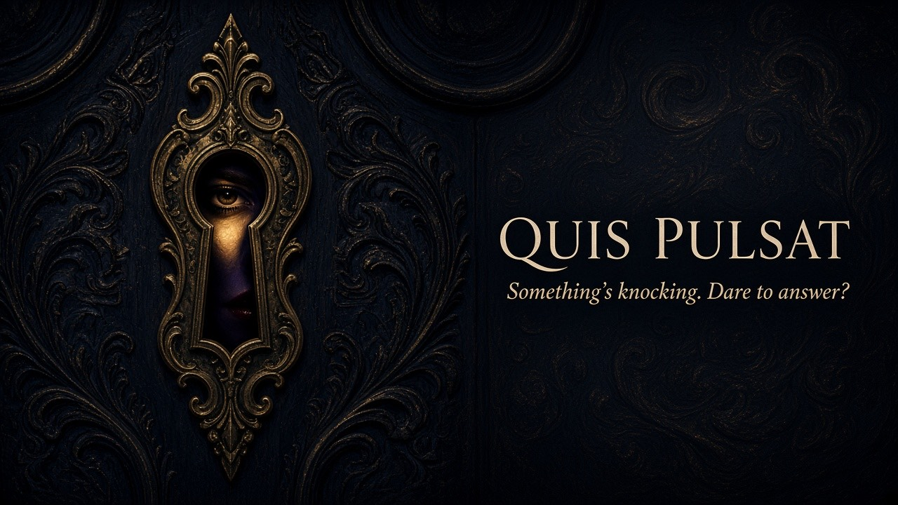
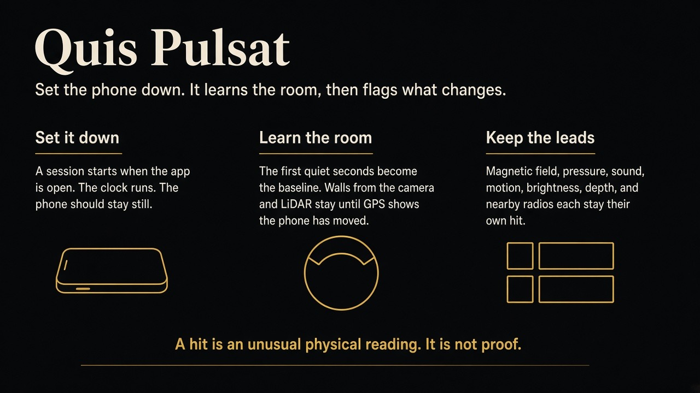

# Quis Pulsat

Version 1.0.2 (build 2).

Quis Pulsat is an iPhone app for investigating places where something feels off. You start a session, set the phone down, and it watches the sensors already on the device: the magnetometer, barometer, microphone, motion sensors, camera, and on Pro models the LiDAR scanner. It learns what the room sounds and feels like for the first few seconds, then flags readings that depart from that baseline.

Those flags are anomalies. A magnetic field that jumps, a pressure step with no door movement you noticed, a sound in a quiet room, the phone registering motion while it should be still. Each hit is saved with a timestamp and the samples around it so you can replay it later and decide what it was. A spike on its own is a lead, not a conclusion. The phone measures physical signals. It does not prove that something supernatural caused them.

Sessions are meant to be run with the phone in hand, in the foreground. The investigator names the place, watches live gauges, and leaves with a log of what changed while they were there.

Sensor-by-sensor detail, what iOS actually exposes, and how the app is structured live in [architecture.md](architecture.md).
