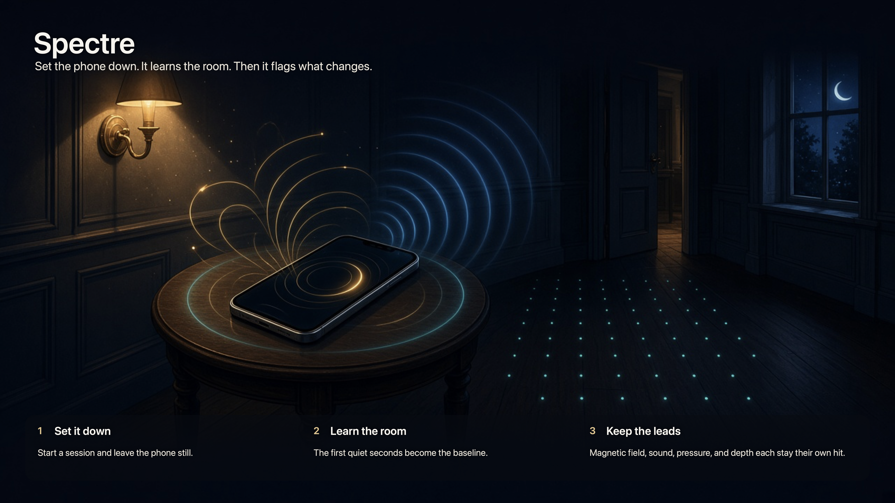
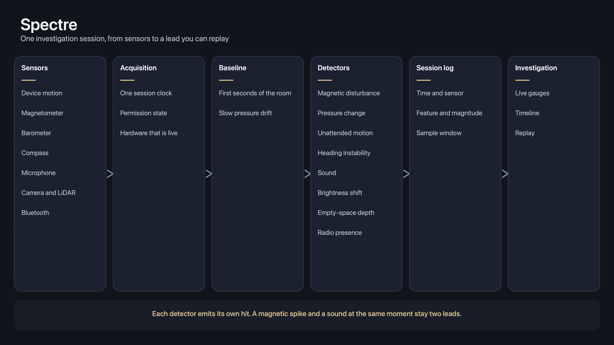

# Spectre Architecture





Spectre is an iPhone app for field investigation. It watches the phone’s sensors, learns a short baseline for the room, and flags physical readings that depart from that baseline. Those departures are **anomalies**: unusual magnetic fields, pressure shifts, sounds, motion, and similar signals. The app presents them as leads an investigator can review. It does not claim a sensor reading is proof of a supernatural event. Measurement stays separate from interpretation.

A session is the unit of work. The investigator starts a session, the phone records synchronized sensor streams, the anomaly engine scores windows of those streams, and the session log keeps the hits with timestamps and raw context so they can be replayed later.

## What the phone can actually sense

iOS exposes the sensors below through public frameworks. Availability varies by model and by permission. “Available” means Apple ships a public API for it, not that every iPhone has the hardware.

| Sensor | Framework | What it measures | Permission | Hardware |
| --- | --- | --- | --- | --- |
| Accelerometer | Core Motion (`CMMotionManager`) | Acceleration on three axes, including gravity, in g | Motion usage string when prompted | All current iPhones |
| Gyroscope | Core Motion | Rotation rate on three axes, in rad/s | Same | All current iPhones |
| Magnetometer | Core Motion | Local magnetic field on three axes, in microteslas (µT) | Same | All current iPhones |
| Sensor fusion | Core Motion (`CMDeviceMotion`) | Attitude, gravity split from user acceleration, rotation rate, calibrated magnetic field and accuracy | Same | All current iPhones |
| Barometer | Core Motion (`CMAltimeter`) | Relative air pressure (kPa) and relative altitude change | None beyond Motion on some OS versions | iPhone 6 and later |
| Absolute altitude | `CMAltimeter` absolute altitude updates | Altitude above mean sea level | When-in-use location | iOS 15+, phones with a barometer |
| GPS | Core Location | Latitude, longitude, reported altitude, speed, course, floor when indoors maps provide it | When-in-use or always location | All current iPhones; weak indoors |
| Compass | Core Location heading | Magnetic and true heading, plus heading accuracy | When-in-use location | All current iPhones |
| Microphone | AVFoundation | Audio samples in the audible band | Microphone | All current iPhones |
| Cameras | AVFoundation | Video and stills; exposure time, ISO, aperture, and lens position as brightness proxies | Camera | Wide, ultra-wide, and telephoto depending on model; front camera on all |
| LiDAR | ARKit scene depth | Per-frame depth and confidence, plus a reconstructed mesh | Camera | Pro models from iPhone 12 Pro onward |
| TrueDepth | ARKit face tracking | Face mesh and a limited depth stream while face tracking is running | Camera | Front camera on Face ID phones. No public raw infrared feed |
| Proximity | UIKit (`UIDevice`) | Binary near / far at the earpiece | None | All current iPhones. Coarse, and only meaningful next to the receiver |
| Pedometer and floors | Core Motion (`CMPedometer`) | Steps, distance, floors ascended or descended, pace, cadence | Motion & Fitness | Motion coprocessor phones |
| Activity | Core Motion (`CMMotionActivityManager`) | Stationary, walking, running, cycling, automotive, plus confidence | Motion & Fitness | Motion coprocessor phones |
| Bluetooth Low Energy | Core Bluetooth | Nearby peripherals, advertisement data, RSSI | Bluetooth | All current iPhones |
| Ultra Wideband | Nearby Interaction | Distance and direction to another UWB device | Nearby Interaction capability | iPhone 11 and later, only while a peer is present |
| NFC | Core NFC | Tag payload during a reader session the user starts | NFC reader entitlement | iPhone 7 and later. Not a continuous scan |
| Thermal state | Foundation (`ProcessInfo`) | Coarse device thermal state: nominal, fair, serious, critical | None | All current iPhones. This is phone heat, not room temperature |

Update rates worth planning for:

- Accelerometer, gyroscope, and device motion: up to about 100 Hz in the foreground.
- Magnetometer: typically tens of hertz, delivered with device motion.
- Barometer: about 1 Hz.
- GPS: about 1 Hz, often worse indoors.
- Microphone: 44.1 kHz or 48 kHz capture, then windowed into levels and a spectrum.
- LiDAR depth: the ARKit frame rate, commonly 60 Hz, with depth at a lower resolution than the camera.

## What an anomaly means here

Each detector compares a live window to a baseline taken at the start of the session (or to a slow rolling baseline when the room is drifting, as weather does to the barometer). A hit stores the time, the sensor, the feature that moved, the magnitude, and a short clip of the surrounding samples.

| Lead | Sensor features | What a hit can mean physically |
| --- | --- | --- |
| Magnetic disturbance | Field magnitude, vector jump, calibrated-field accuracy falling to “low” or “unreliable” | Nearby magnets, speakers, wiring, steel, a phone case magnet, or the investigator’s own movement through a distorted field. This is not an RF EMF meter. |
| Pressure change | Short-term delta in relative pressure after removing the slow weather trend | Doors, HVAC, drafts, elevation change. Sudden steps are the interesting ones. |
| Heading instability | Heading accuracy worsening, or yaw wander while the phone is still | Magnetic interference. Cross-check against the magnetometer so a turned phone is not logged as a hit. |
| Unattended motion | User acceleration and rotation while the “device is at rest” flag is set | Bumps, floors flexing, a table shifting. Ignore samples while the pedometer says the user is walking. |
| Sound | RMS level, transient peaks, and narrow tones in an otherwise quiet spectrum | Voices, appliances, plumbing, the investigator. Capture is limited to the audible band the microphone passes. |
| Brightness shift | Camera exposure, ISO, and average luma while the camera is metering the room | Lights, clouds, someone walking through a beam. iOS has no public lux sensor. |
| Empty-space depth | LiDAR depth changing in a region the mesh previously marked empty | A person, a pet, steam, a reflective surface, or sensor noise. Only on LiDAR phones. |
| Radio presence | New BLE advertisement, or a sharp RSSI change | A phone, watch, tracker, or other peripheral entering range. |

Detectors should stay independent. A magnetic spike and a pressure step at the same timestamp are two leads that happen to coincide, not a single fused “entity” score. Correlation across leads can be shown in the session timeline without collapsing them into one verdict.

## Sensors and signals iOS does not give us

Classic investigation gear does not map onto the phone. These are out of scope because there is no public API, or the hardware is not comparable:

- **RF EMF.** The magnetometer reads the static and slowly changing magnetic field (Earth’s field plus local magnets and current in nearby wiring). It does not measure radio-frequency electromagnetic fields the way a handheld EMF meter does.
- **Ambient light in lux.** No public light-sensor API. Brightness has to be inferred from the camera’s auto-exposure metadata, which also reacts to where the lens is pointed.
- **Room temperature and phone temperature.** `ProcessInfo.thermalState` is a coarse throttle signal for the device, not a thermometer.
- **Infrasound and ultrasound as people usually mean them.** The microphone is built for speech and hearing. Energy well below ~20 Hz and well above ~20 kHz is heavily attenuated. A spectrum display should be labeled with the real passband, not “infrasound.”
- **Raw TrueDepth infrared.** Face tracking exposes a face mesh, not the IR camera stream.
- **A continuous NFC or Wi-Fi sweep.** NFC runs only in a user-started reader session. Current-network SSID access is restricted, entitlement-gated, and is not a scan of nearby networks.
- **UWB ranging to arbitrary objects.** Nearby Interaction measures distance to another Ultra Wideband device that is in a session with the phone. It does not range walls, people, or empty air.
- **Background high-rate sensing.** Accelerometer, magnetometer, barometer, camera, and LiDAR streams are foreground features. Location and audio can continue in the background only under the matching background modes, and audio-in-the-background is a poor fit for an investigation tool that should be obviously recording.

## Runtime shape

```text
Sensors (Core Motion, Core Location, AVFoundation, ARKit, Core Bluetooth)
        │
        ▼
Acquisition          one clock, per-sensor samples, permission state
        │
        ▼
Baseline             first N seconds of a quiet room, plus slow drift for pressure
        │
        ▼
Detectors            one detector per lead in the table above
        │
        ▼
Session log          hits + the sample window around each hit
        │
        ▼
Investigation UI     live gauges, timeline, replay
```

Acquisition owns permissions and hardware checks (`isAccelerometerAvailable`, `isGyroAvailable`, `isMagnetometerAvailable`, `isRelativeAltitudeAvailable`, LiDAR support via ARKit). Detectors never touch frameworks directly. They consume timestamped samples and emit hits. The UI reads the session log and the latest sample for each gauge.

Device motion is the preferred motion source when it is available, because it already separates gravity from user acceleration and attaches a magnetic-field accuracy estimate. Raw accelerometer and magnetometer stay available for detectors that need the unfused vector.

A session should record which sensors were live. A phone without LiDAR simply omits depth. A denied microphone permission omits sound and says so, rather than logging silence as a quiet room.

## Permissions to declare

| Key | Why |
| --- | --- |
| `NSMotionUsageDescription` | Accelerometer, gyroscope, magnetometer, pedometer |
| `NSLocationWhenInUseUsageDescription` | GPS, compass heading, absolute altitude |
| `NSMicrophoneUsageDescription` | Sound leads and replayable audio around a hit |
| `NSCameraUsageDescription` | Brightness proxy and, on Pro models, LiDAR |
| `NSBluetoothAlwaysUsageDescription` | Nearby BLE peripherals during a session |

Copy should say that the app is recording that sensor for an investigation session. Location, if used, stays when-in-use: a session is something the investigator runs with the phone in hand.

## Suggested build order

1. Session clock, motion pipeline (device motion + barometer), and a magnetic-disturbance detector against a short baseline.
2. Session log and a timeline that can replay a hit.
3. Microphone level and spectrum, gated on a quiet-room baseline.
4. Compass heading cross-check so magnetic hits and heading hits share one explanation.
5. Camera brightness proxy.
6. LiDAR empty-space check on devices that support scene depth.
7. BLE appearance log.

GPS matters for placing a session on a map later. It is a weak anomaly source indoors, so it should not block the first detectors.
